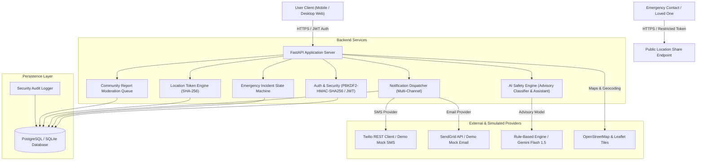
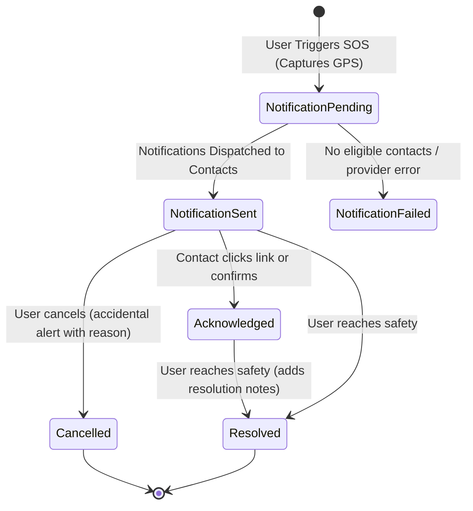

# SURAKSHA AI — System Architecture & Technical Specifications

## 1. Executive Summary

**SURAKSHA AI** is a production-minded web application engineered to empower women, coordinate real-time emergency alerts, share cryptographically restricted locations, and crowd-source verified safety reports.

---

## 2. Architecture Diagram & Data Flow



---

## 3. Emergency Incident State Machine

Every emergency alert transitions strictly through a validated, auditable state machine:



### State Integrity Rules
- An alert is recorded transactionally **before** external network dispatch is attempted.
- A failed SMS or email provider delivery does **not** erase the active emergency incident.
- If an external provider is unconfigured, the system honestly reports `"Provider unconfigured (Demo Mock Delivered)"` rather than falsely claiming delivery.
- State-changing actions log an immutable entry into `audit_events`.

---

## 4. Cryptographic Security & Privacy by Design

### A. Location Privacy & Tokens
- Continuous tracking is **never** performed without explicit user activation.
- Location sharing sessions generate a 32-byte cryptographically random token (`generate_random_token`).
- Only the **SHA-256 hash** of the token is persisted in the database (`token_hash`).
- The public tracking endpoint (`/api/public/location-shares/{raw_token}`):
  - Validates `token_hash == sha256(raw_token)`
  - Verifies `now() < expires_at` and `revoked_at IS NULL`
  - Returns only safe coordinates, accuracy, and first name.
  - Zero database IDs, emails, phone numbers, or passwords are ever exposed.

### B. Password Security
- Complies with NIST SP 800-63B guidelines.
- PBKDF2-HMAC-SHA256 password hashing with 100,000 iterations and 16-byte random salt.
- Prevents compilation failures across varying operating systems and architectures.

### C. Public Hazard Coordinate Fuzzing
- To protect community reporters' privacy, public safety report coordinates are fuzzed/rounded to 3 decimal places (~110 meters), preventing exact address triangulation of private residences.

---

## 5. Technology Stack & Directory Structure

```
suraksha-ai/
├── backend/
│   ├── app/
│   │   ├── api/
│   │   │   ├── deps.py              # Auth & admin dependency injection
│   │   │   └── endpoints/
│   │   │       ├── auth.py          # Register, login, logout, me
│   │   │       ├── profile.py       # Profile & password management
│   │   │       ├── contacts.py      # Trusted contacts CRUD (max 10)
│   │   │       ├── incidents.py     # SOS trigger, cancel, resolve, ack
│   │   │       ├── location_shares.py # Cryptographic live sharing
│   │   │       ├── reports.py       # Community hazards & AI tagging
│   │   │       ├── checkins.py      # Travel safety check-in countdown
│   │   │       ├── admin.py         # Moderation queue & telemetry
│   │   │       ├── ai.py            # Safety assistant & classifier
│   │   │       ├── notifications.py # In-app notifications
│   │   │       └── system.py        # /health, /ready, demo seed
│   │   ├── core/
│   │   │   ├── config.py            # Pydantic Settings
│   │   │   ├── database.py          # SQLAlchemy Session & Engine
│   │   │   └── security.py          # PBKDF2 hashing & JWT
│   │   ├── models/
│   │   │   └── entities.py          # Normalized SQLAlchemy models
│   │   ├── schemas/
│   │   │   └── all_schemas.py       # Pydantic V2 validated schemas
│   │   ├── services/
│   │   │   ├── emergency_service.py # State transitions & audit
│   │   │   ├── notification_service.py # Multi-channel provider abstraction
│   │   │   ├── ai_service.py        # Explainable classifier & assistant
│   │   │   └── audit_service.py     # Audit event logging
│   │   └── main.py                  # FastAPI root with CORS & Lifespan
│   ├── tests/
│   │   └── test_api.py              # 9 Comprehensive Pytest test cases
│   ├── Dockerfile
│   └── requirements.txt
├── frontend/
│   ├── src/
│   │   ├── components/
│   │   │   ├── Navbar.tsx           # Responsive header & SOS pill
│   │   │   ├── Footer.tsx           # Safety disclaimers & hotlines
│   │   │   ├── EmergencyBanner.tsx  # Active emergency persistence banner
│   │   │   ├── SimulatedCallModal.tsx # Discrete escape incoming call tool
│   │   │   └── VoiceSosListener.tsx # Web Speech API voice trigger
│   │   ├── context/
│   │   │   └── AuthContext.tsx      # Auth & active incident state
│   │   ├── lib/
│   │   │   └── api.ts               # Typed client fetch wrapper
│   │   ├── pages/
│   │   │   ├── LandingPage.tsx      # High-conversion public landing
│   │   │   ├── LoginPage.tsx        # Sign In with 1-click Demo buttons
│   │   │   ├── RegisterPage.tsx     # Registration with medical notes
│   │   │   ├── DashboardPage.tsx    # Central SOS command center
│   │   │   ├── EmergencyPage.tsx    # Dedicated Emergency SOS Center
│   │   │   ├── ContactsPage.tsx     # Guardian contact management
│   │   │   ├── LocationSharingPage.tsx # Map-based live token generator
│   │   │   ├── PublicTrackingPage.tsx # Restricted public tracking view
│   │   │   ├── NearbyAssistancePage.tsx # Police & hospital map directory
│   │   │   ├── CommunityReportsPage.tsx # Crowdsourced safety hazard map
│   │   │   ├── CheckInsPage.tsx     # Journey arrival countdown timer
│   │   │   ├── SafetyAssistantPage.tsx # AI chat guidance
│   │   │   ├── EmergencyHistoryPage.tsx # Past alerts audit log & export
│   │   │   ├── ProfilePage.tsx      # User settings & account deletion
│   │   │   └── AdminPage.tsx        # Report moderation & telemetry
│   │   ├── types/
│   │   │   └── index.ts             # TypeScript definitions
│   │   ├── App.tsx                  # React Router configuration
│   │   ├── main.tsx                 # Entrypoint
│   │   └── index.css                # Tailwind directives & glow effects
│   ├── Dockerfile
│   ├── nginx.conf
│   └── package.json
├── docker-compose.yml               # Multi-container deployment
├── .env.example                     # Documented configuration template
├── start_dev.py                     # Unified development launcher
└── README.md                        # Master documentation
```
